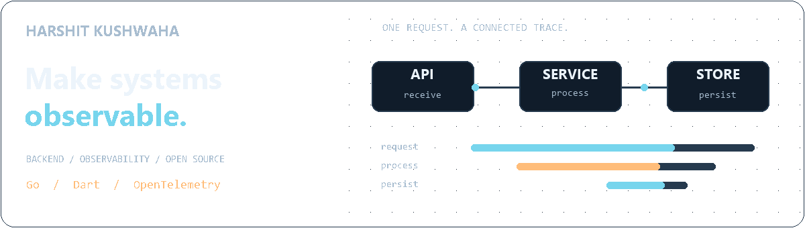

  

 

  

  

    <table width="100%" style="table-layout: fixed;">
        <tr>
            <!-- Profile introduction -->
            <td colspan="2" width="100%" align="left" valign="top">
<h1 align="center">Hi, I'm Harshit Kushwaha</h1>
<h3 align="center">Software engineer &amp; open-source contributor</h3>
<ul>
  <li>Building backend systems and observability tools.</li>
  <li>Contributing to OpenTelemetry in Go and Dart.</li>
  <li>Outside code: video games, sketching, and photography.</li>
</ul>

<a href="https://harshitt13.in">Portfolio</a> &middot; <a href="https://linkedin.com/in/harshitt13">LinkedIn</a> &middot; <a href="https://github.com/search?q=is%3Apr+author%3Aharshitt13+is%3Amerged&amp;type=pullrequests">Merged contributions</a>

            </td>
        </tr>
        <tr>
            <!-- Spotify embed on the left side -->
            <td width="50%" align="center" valign="middle">
                
            </td>
            <!-- GIF on the right side -->
            <td width="50%" align="center" valign="middle">
                
            </td>
        </tr>
        <tr>
            <td colspan="2" align="left">
                <h3>Core stack</h3>
                
<strong>Languages</strong> &nbsp; Go &middot; Dart &middot; Python &middot; TypeScript

                
<strong>Focus</strong> &nbsp; OpenTelemetry &middot; Distributed tracing &middot; Backend APIs

                
<strong>Tools</strong> &nbsp; Git &middot; Docker &middot; GitHub Actions

            </td>
        </tr>
        <tr>
            <td width="50%" align="center" valign="middle" style="text-align: center; vertical-align: middle;">
                

                    
                

            </td>
            <td width="50%" align="center" valign="middle" style="text-align: center; vertical-align: middle;">
                

                    
                

            </td>
        </tr>
        <tr>
            <td width="50%" align="center" valign="top" style="text-align: center;">
                

                    
                

            </td>
            <td width="50%" align="center" valign="top" style="text-align: center;">
                

                    
                

            </td>
        </tr>
    </table>

 

    

